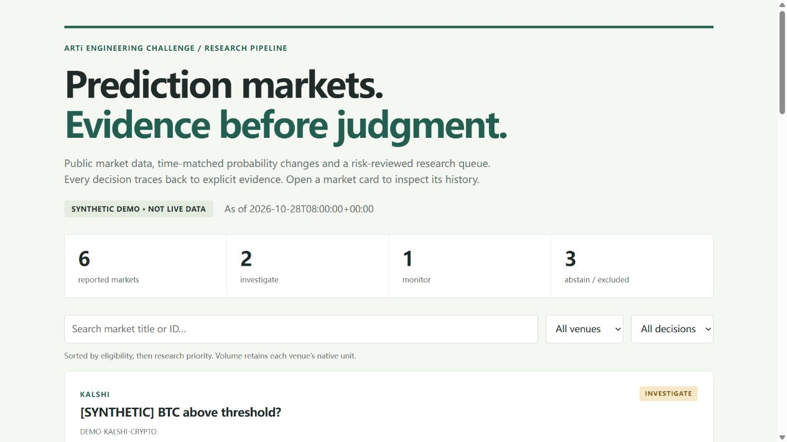
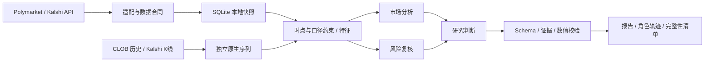

# Prediction Market Research

**Polymarket × Kalshi：从公开市场数据到可追溯的研究判断。**

为 [ARTi AI 研究工程师挑战](https://www.artifin.ai/join/ai-research-engineer)实现的 Python 原型：公开 API 接入、市场筛选、概率追踪、异常检测，以及 TradingAgents 启发的分析／风险／判断流程。输出带证据与数值校验的 JSON、自包含 HTML、Markdown 和角色运行轨迹。

运行仅需 **Python 3.11+ 标准库**，默认无需密钥。可选接入兼容 `chat/completions` 的模型。`investigate` 表示值得人工调查，不能解释为买入、套利或预期收益。

## 60 秒复现

在仓库根目录运行：

```bash
# 不联网：156 条合成快照，6 个市场，展示调查／观察／弃权
python -m market_research demo

# 不联网：重放双平台真实采集，包含原生历史序列
python -m market_research replay --bundle examples/live-v2/snapshot_bundle.json --out reports/replay

# 不联网：288 个合成案例，四种方法对照，保留误报与失败
python -m market_research evaluate

# 校验报告及角色轨迹的文件完整性
python -m market_research verify --dir reports/replay
```

打开 `reports/demo/report.html` 或 `reports/replay/report.html`。报告支持搜索、平台／决策筛选，展开市场可看证据、结构化判断及历史曲线。GitHub 不执行 HTML；下载后用浏览器打开。

已生成：[合成演示](examples/demo/report.html) · [真实报告](examples/live-v2/report.md) · [合成评测](examples/evaluation/evaluation.md) · [开源对照与升级决策](docs/REFERENCE_REVIEW.md)。



## 真实数据：当前快照与原生历史

```bash
# 实时公开接口；每家最多对 3 个合格市场读取过去 48h 原生历史
python -m market_research collect --history-per-source 3 --out reports/live

# 默认不回填；重复运行、保持同一 SQLite 文件可累积本地快照
python -m market_research collect --db data/live.sqlite3

# 限定 Kalshi 宏观系列；每系列默认最多两页、每页 100 条
python -m market_research collect --source kalshi --kalshi-series KXFEDDECISION KXCPI

# 有限页扫描全系列；仍不代表全市场覆盖
python -m market_research collect --source kalshi --kalshi-series ALL --max-pages 3

# 按历史时点分析数据库
python -m market_research analyze --as-of "2026-10-28T08:50:23.924684+00:00"
```

v0.2 真实采集于 **2026-10-28 16:50:23 中国标准时间**（08:50:23 UTC），见 [快照与历史包](examples/live-v2/snapshot_bundle.json)。

| 来源 | 标准化市场 | 跳过 | 覆盖范围 |
|---|---:|---:|---|
| Polymarket | 169 | 31 | 按滚动 24h 量扫描 200 条；非 Yes/No 二元市场跳过，达到页数上限 |
| Kalshi | 121 | 0 | KXFEDDECISION、KXCPI、KXGDP 三个宏观系列，排除组合市场 |
| 合计 | 290 | 31 | 112 个通过筛选；报告展示前 20 个 |

两家接口无采集错误。6 条原生序列共 **1,779 个历史点**，其中 4 条对应前 20 个报告市场。20 个结果均为 `monitor`，如实保留未触发异常的结果。样例包含[原始市场片段](examples/live-v2/raw_sample.json)及[原始历史片段](examples/live-v2/native_raw_sample.json)，均明确标记截取；完整原始响应在本地 `data/runs/`。

历史分为两条独立路径：

- **本地快照**：在本程序实际观测时记录完整元数据；变化基准要求同市场、同规则、同价格口径、同成交量单位。
- **原生序列**：Polymarket CLOB 的 YES token 历史价格，或 Kalshi 小时 K 线的 YES 收盘双边报价中间值。保留 `event_time` 和本次取得序列的 `received_at`。本地概率变化不可用时，用原生序列内部计算的变化；不把 Gamma 当前价与 CLOB 历史价相减。图中展示原始点，检测使用小时边界附近的真实样本，不插值。

回填不能证明历史时点已知当时的规则或元数据，不能伪装成实时历史观察。分析要求 `received_at <= as_of`，原生最新点距分析时点最多 90 分钟。原生 K 线内成交量和滚动 24h 成交量分开保存，不能互换。

保留的[首轮真实样例](examples/live/report.md)展示没有原生回填的冷启动：296 个市场、历史变化为 `null`。合成演示单独标识，不补进真实市场历史。

## 架构与数据口径



参考 [TradingAgents](https://github.com/TauricResearch/TradingAgents) 的角色分工独立实现，未复制其代码。三个角色是显式函数；默认模式是确定性规则，可选模型仅在最终判断阶段调用一次。没有接入 LangGraph，也不将 JSONL 轨迹称为可恢复 checkpoint。参考版本、Star 观察值与取舍见[对照记录](docs/REFERENCE_REVIEW.md)。

| 字段 | 语义 |
|---|---|
| `source`, `market_id` | 平台内唯一身份；不自动合并相似标题 |
| `observed_at` | 本程序收到市场 API 页面的 UTC 时间 |
| `source_updated_at` | 平台元数据时间，不能证明报价新鲜度 |
| `probability`, `probability_basis` | YES 隐含概率及价格口径；未知为 `null` |
| `yes_bid`, `yes_ask` | YES 双边报价，空盘口不补零 |
| `volume_24h`, `volume_unit` | 滚动 24h 活跃度；Polymarket 为 USD，Kalshi 为 contracts |
| `liquidity_usd` | 平台报告的美元流动性；Kalshi 无对应口径，保留 `null` |
| `close_time`, `rules`, `issues` | 预计结束时间、结算规则、数据质量提示 |

Polymarket 按 Yes 标签定位价格和 token，兼容结果顺序变化。Kalshi 优先使用美元及定点字段，兼容旧美分字段；有效双边报价取 midpoint，last trade 回退不会绕过双边盘口筛选。

## 筛选与检测方法

硬性门槛：开放、未超过预计结束时间、有规则／概率／双边报价；价差 ≤8 pp，概率 2%–98%；滚动 24h 量至少 Polymarket 1,000 USD／Kalshi 100 contracts；本地快照在分析时点前 30 分钟内，不在未来。结束时间和快照年龄均相对**分析时点**校验。

合格市场的启发式优先级为 `100 × (0.35 × 活跃度 + 0.25 × 概率熵 + 0.20 × 报价质量 + 0.20 × 异常强度)`，不是收益预测或概率校准。平台分别缩放成交量，不直接比较原始单位。

| 信号 | 方法 | 数据不足 |
|---|---|---|
| 1h 变化 | 同口径基准，时间容差 15min；绝对变化 ≥5 pp | `null` |
| 24h 变化 | 时间容差 2h；绝对变化 ≥10 pp | `null` |
| 活跃度激增 | 当前滚动 24h 量／一天前滚动 24h 量 ≥3，分母达到平台最低量 | 不触发 |
| 异常小时变化 | ≥8 个先前、间隔 0.5–1.5h 的变化率；MAD 稳健 z，绝对值 ≥4 | `null` |

MAD 基准排除待检测的最后一次变化，尺度下限 0.5 pp/h。输出包含实际间隔、基准时间与来源。滚动成交量比不代表这段时间新增成交量。阈值与消融开关可通过[配置文件](config.example.toml)调整：

```bash
python -m market_research demo --config config.example.toml
python -m market_research evaluate --config config.example.toml --out reports/custom-eval
```

## 判断与模型边界

输出限定为 `investigate / monitor / abstain`。除摘要、风险和下一步外，必须给出 `evidence_ids` 与结构化数值 `claims`。完整输出见 [demo JSON](examples/demo/report.json)，schema 与 prompt 见 `market_research/agents.py`。校验引用存在、数值、符号、单位及风险门槛；没有信号不能输出 investigate。自由文本仍可能误读事实，这些检查不能证明整段摘要的语义忠实度。

可选模型配置（PowerShell；程序不自动读取 `.env`）：

```powershell
$env:LLM_BASE_URL = "https://your-provider.example/v1"
$env:LLM_MODEL = "your-model-id"
$env:LLM_API_KEY = "your-key"
python -m market_research collect --llm --llm-top 3
```

默认发送原生 strict `json_schema`。服务仅支持 JSON object 时显式设置 `LLM_RESPONSE_FORMAT=json_object`，本地校验仍保留。需要兼容 `max_tokens`；HTTPS 默认要求，localhost 允许 HTTP。最多调用前 3 个合格条目，记录耗时与返回的 token；失败、拒绝、截断或非法输出均可观察地弃权，付费 POST 不重试。**本次没有调用真实付费模型，仅以 mock 验证接口边界。**

## 评测、轨迹与验证

288 个明确标注的合成案例覆盖 12 类机制；校准／留出使用不同随机种子，阈值未由评测自动选择。144 例留出上的结果：

| 方法 | 三类 macro F1 | 风险门槛 |
|---|---:|---|
| 固定跳价阈值 | 0.7423 | 保留 |
| 加入稳健 z | 0.8615 | 保留 |
| 加入活跃度信号 | 0.9568 | 保留，仍有 6 次误报 |
| 移除风险门槛 | 0.5063 | 48/48 应弃权案例被放行 |

这衡量**手工设计的合成机制**，相同机制换种子不等于独立真实市场验证。不可称为 95.68% 真实准确率。报告保存混淆矩阵、每类指标及全部失败，见[评测协议](docs/EVALUATION_PROTOCOL.md)。下一步需要固定真实观察列表、独立标注和时间留出；LLM 质量要另测。

每份报告保存代码／输入摘要、配置、输入派生 run ID、prompt/schema 哈希和 `trace.jsonl`。`verify` 校验 HTML／JSON／Markdown／轨迹的 SHA256；这不是数字签名或可信时间戳。run ID 标识实验输入，不保证模型每次生成相同文本。

```bash
python -m pip install -e ".[dev]"
python -m ruff check .
python -m pytest -q
```

Windows / Python 3.12.7 本地 **61 项测试通过**，Ruff 通过。CI 配置覆盖 Python 3.11–3.13，并运行 demo、verify、evaluate；发布前未声称云端 CI 已通过。详细结果见[验证记录](docs/VALIDATION.md)。

## 文件导览与限制

`adapters.py` / `native_history.py` 接入公开 API；`store.py` 保存双类历史；`analysis.py` 计算特征；`agents.py` 判断与校验；`audit.py` 管理轨迹；`evaluation.py` 生成压力评测；`cli.py` 提供命令。设计取舍见 [DESIGN](docs/DESIGN.md)，提交导览见 [SUBMISSION](SUBMISSION.md)。数据库、缓存与私有简历不进入源码包。

REST 轮询与有限页扫描不能保证全市场覆盖；平台元数据不能保证 tick 新鲜度；原生历史没有历史规则版本。当前没有新闻检索、盘口深度、费用／滑点、长期真实评测或结算概率校准，不报告 Alpha 或收益。跨平台事件对齐仍需人工核对阈值、时间与结算来源。

官方接口：[Polymarket markets](https://docs.polymarket.com/api-reference/markets/list-markets)、[price history](https://docs.polymarket.com/developers/CLOB/timeseries)、[Kalshi markets](https://docs.kalshi.com/api-reference/market/get-markets)、[candles](https://docs.kalshi.com/api-reference/market/get-market-candlesticks)。招聘要求与参考资料核验于 2026-10-28。
